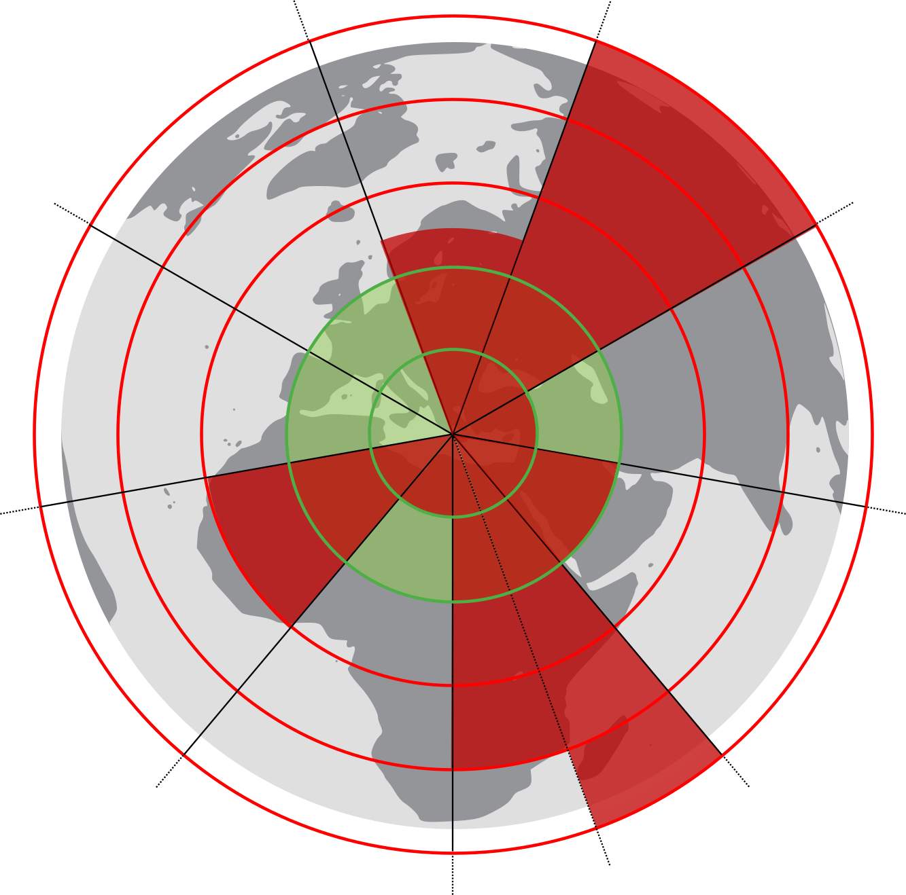
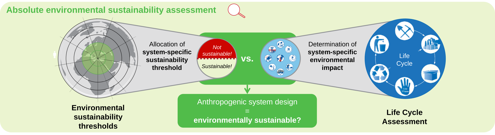

<h1>
  
  pbaesa
</h1>


[][pypi status]
[][pypi status]
[][pypi status]
[][pre-commit]
[][black]

[pypi status]: https://pypi.org/project/pbaesa/
[pre-commit]: https://github.com/pre-commit/pre-commit
[black]: https://github.com/psf/black


pbaesa is a python package for planetary-boundary-based absolute environmental sustainability assessment of anthropogenic systems.

## 🌍 Features

pbaesa enables:

1) The assessment of system-specific impacts on all global planetary boundary categories except novel entities by integration new life cycle impact assessment methods into the [Brightway LCA framework](https://docs.brightway.dev/en/latest).
2) The calculation of system-specific sustainability thresholds from time-explicit multi-regional input-output tables.

<br>

<div style="margin: 0;">
  <picture style="display: block; width: 100vw;">
    <source media="(prefers-color-scheme: dark)" srcset="docs/_static/AESA.svg">
    
  </picture>
</div>


## ⚙️ Installation

You can install _pbaesa_ via [pip] from [PyPI]:

```console
$ pip install pbaesa
```

## 🚀 Usage

### Basic Example

```python
import bw2data as bd
import pbaesa
from pbaesa import utils

# Set your Brightway project
bd.projects.set_current('your_project_name')

# Load your biosphere database
bio = bd.Database("ecoinvent-3.10.1-biosphere")

# Create all planetary boundary LCIA methods
pbaesa.create_pbaesa_methods(biosphere_db=bio)

# Get allocation factors for a specific sector and location
allocation_factors = pbaesa.get_all_allocation_factor(
    geographical_scope="DE",  
    sector="Cultivation of wheat",
    year=2022
)

# Calculate a multi-LCA using Brightway to obtain mlca_scores

# Calculate exploitation of global safe operating space 
utils.calculate_exploitation_of_SOS(mlca_scores)

# Plot exploitation of global safe operating space against allocation factors
utils.plot_AESA(exploitations, allocation_factor_total_FCE, allocation_factor_total_GVA)

```

### Key Functions

- **`create_pbaesa_methods(biosphere_db, process_ids=[])`**: Creates and registers LCIA methods for all global planetary boundary categories except novel entities (climate change, ocean acidification, biosphere integrity, phosphorus cycle, atmospheric aerosol loading, freshwater use, stratospheric ozone depletion, land-system change, and nitrogen cycle).

- **`get_all_allocation_factor(geographical_scope, sector, year)`**: Retrieves allocation factors for a specific sector and geographical scope. If the allocation factors file is not present, the function will generate it automatically.

For a more detailed example, see the `examples/` directory.

## 📚 Citation

`pbaesa` implements the methodology presented in:

> **Hartmann, J. M., Shu, D. Y., Bardow, A., & von der Assen, N. (2026).**  
> *Allocation and characterisation factors for absolute environmental sustainability assessment*.  
> **Scientific Data, 13**, Article 970.  
> https://doi.org/10.1038/s41597-026-07797-w

- If you use `pbaesa` in academic work, please cite this publication.
- The paper provides the methodological background and describes the derivation and validation of the allocation and characterisation factors implemented in `pbaesa`.

## 📦 Datasets

`pbaesa` uses the following openly available datasets, which are automatically downloaded and processed where appropriate:

- **Allocation Factors for Absolute Environmental Sustainability Assessment**  
  Provides allocation factors for **163 economic sectors** across **44 countries** and **5 Rest-of-World regions** based on four economic allocation principles. These factors are used to derive sector-specific shares of the global safe operating space.  
  https://zenodo.org/records/20523866

- **Characterisation Factors for Planetary-Boundary-Based Absolute Environmental Sustainability Assessment**  
  Provides characterisation factors for **2,684 elementary flows** in the standard and prospective **ecoinvent v3.10.1** databases, covering all global planetary boundary categories except novel entities. The dataset also includes the global safe operating space values used by `pbaesa`.  
  https://zenodo.org/records/17457702

## 🤝 Contributing

We welcome contributions! If you have suggestions or want to fix a bug, please:
- [Open an Issue](https://github.com/RWTH-LTT/pbaesa/issues)
- [Send a Pull Request](https://github.com/RWTH-LTT/pbaesa/pulls)

## 🧾 License and Data Notice

This project is licensed under the MIT License — see the [LICENSE](LICENSE) file for details.

© 2025 Institute of Technical Thermodynamics, RWTH Aachen University

This repository does **not** include any EXIOBASE 3 data or derived coefficients.  
Users must obtain EXIOBASE data directly from the official EXIOBASE source.  
Please ensure you comply with the EXIOBASE license terms when using their data.

> **Note:** This code is released under the MIT License.  
> The MIT License allows both commercial and non-commercial use of the **code**,  
> but EXIOBASE data may have its own separate restrictions.

## 💬 Support

If you have any questions or need help, do not hesitate to contact me:

- Jan Hartmann (jan.hartmann@ltt.rwth-aachen.de)
